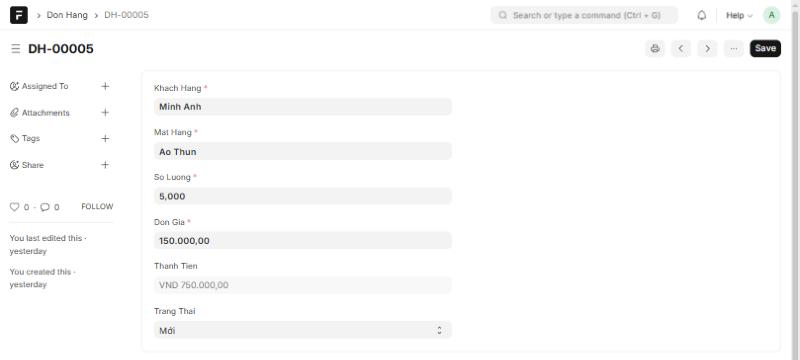
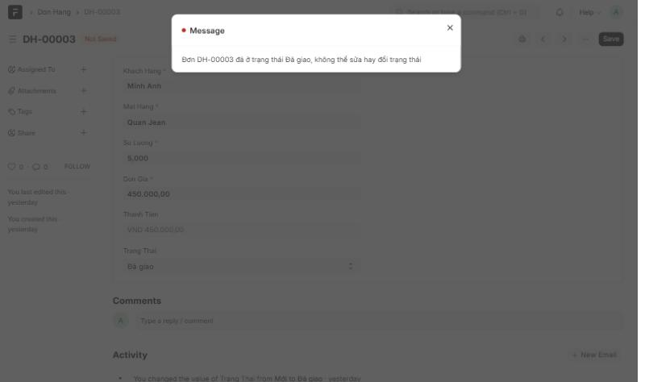
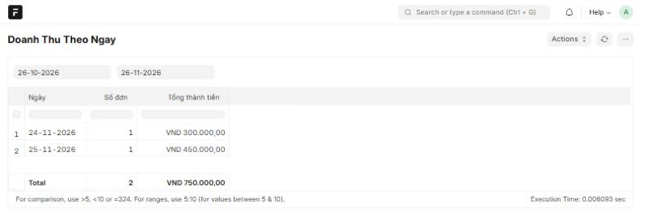

# Order Management

App Frappe nhỏ để quản lý đơn hàng: tạo đơn, chuyển trạng thái, xem báo cáo doanh thu theo ngày.
Làm cho bài test vị trí Lập trình viên ERP/CRM.

## Yêu cầu

- Frappe **v15** (đã chạy thử trên Ubuntu 24.04 trong WSL2)
- Python 3.10+, Node 18, MariaDB 10.6+, Redis

## Cài đặt

```bash
cd frappe-bench
bench get-app https://github.com/NHQAdev/order_management
bench --site <ten-site> install-app order_management

# (Tùy chọn) tạo dữ liệu mẫu: 3 khách hàng, 3 mặt hàng, 4 đơn hàng
bench --site <ten-site> execute order_management.demo.tao_du_lieu_mau

bench start
```

Đăng nhập Desk tại `http://localhost:8000`, sau đó mở:

- Danh sách đơn hàng: `/app/don-hang`
- Báo cáo: `/app/query-report/Doanh%20Thu%20Theo%20Ngay`, hoặc gõ "Doanh Thu Theo Ngay" vào ô tìm kiếm

## Chạy test

```bash
bench --site <ten-site> set-config allow_tests true
bench --site <ten-site> run-tests --app order_management
```

Có 10 test, gồm: tính thành tiền, kiểm tra số lượng và đơn giá, các trường hợp chuyển trạng thái, chặn sửa và chặn xóa đơn đã chốt, báo cáo theo ngày.
Test tự rollback dữ liệu sau khi chạy.

## Cấu trúc chính

order_management/
├── demo.py # script tạo dữ liệu mẫu
└── order_management/
├── doctype/
│ ├── khach_hang/ # Khách hàng
│ ├── mat_hang/ # Mặt hàng
│ └── don_hang/
│ ├── don_hang.json # định nghĩa các trường
│ ├── don_hang.py # toàn bộ kiểm tra ở server
│ └── test_don_hang.py # test tự động
└── report/
└── doanh_thu_theo_ngay/ # Script Report

## Quy tắc nghiệp vụ và cách làm

Mọi kiểm tra đều đặt trong `DonHang.validate()` ở server. Hàm này chạy ở mọi lần lưu, dù dữ liệu đến từ form, REST API hay import, nên client không vượt qua được.

| Yêu cầu | Cách làm |
|---|---|
| Thành tiền = số lượng × đơn giá | Server luôn tự tính lại và bỏ qua giá trị client gửi lên. Field để Read Only. |
| Số lượng, đơn giá > 0 | `frappe.throw` nếu ≤ 0 |
| Đơn mới ở trạng thái **Mới** | Tạo đơn với trạng thái khác sẽ bị từ chối |
| Mới → Đã giao / Hủy | Luật chuyển trạng thái nằm trong bảng `CHUYEN_TRANG_THAI_HOP_LE`. Trạng thái cũ lấy từ database qua `get_doc_before_save()`. |
| Đơn đã giao hoặc đã hủy không sửa được | Trạng thái cũ là Đã giao hoặc Hủy thì chặn mọi lần lưu. Chặn thêm cả xóa trong `on_trash`. |
| Báo cáo theo ngày | SQL `GROUP BY DATE(creation)`, chỉ lấy đơn **Đã giao**, có lọc từ ngày đến ngày và dòng tổng |

## Giả định

1. Frappe không có sẵn Customer và Item (hai DocType này thuộc ERPNext), nên mình tạo hai DocType tối giản là **Khach Hang** và **Mat Hang**.
2. "Ngày tạo đơn" lấy theo trường hệ thống `creation`. Frappe lưu trường này theo **múi giờ hệ thống**, nên site cần đặt time zone là `Asia/Ho_Chi_Minh` để báo cáo ra đúng ngày.
3. Số lượng dùng kiểu Float để cho phép số lẻ (ví dụ kg). Đơn giá và thành tiền dùng kiểu Currency.
4. Đơn đã giao hoặc đã hủy cũng không xóa được. Đề không yêu cầu điều này, nhưng nếu cho xóa thì người dùng có thể xóa rồi tạo lại để "sửa" đơn.
5. Chưa phân quyền riêng, dùng quyền mặc định của System Manager.
6. `frappe.db.set_value` và SQL trực tiếp bỏ qua `validate()`. Hai cách này chỉ dùng trong code nội bộ (dữ liệu mẫu, test), không mở cho người dùng.

## Chưa làm / có thể cải thiện

- Form chưa tính thành tiền ngay khi gõ, phải lưu mới thấy. Có thể thêm `don_hang.js`, server vẫn là nơi tính chính thức.
- Form chưa khóa ở phía client với đơn đã chốt. Server vẫn chặn, nhưng người dùng chỉ thấy lỗi khi bấm lưu.
- Mỗi đơn chỉ có một mặt hàng, đúng theo đề. Nếu cần nhiều mặt hàng thì chuyển sang dùng child table.

## Ảnh chụp màn hình

| Tạo đơn | Đổi trạng thái | Báo cáo |
|---|---|---|
|  |  |  |
